# mini-redis-java

A small Redis-like key-value server written in Java, and a demo shop that uses it as its cache.

Full project report: [report/Redis_Mini_Project_Report.pdf](report/Redis_Mini_Project_Report.pdf)

## System diagrams

### System architecture

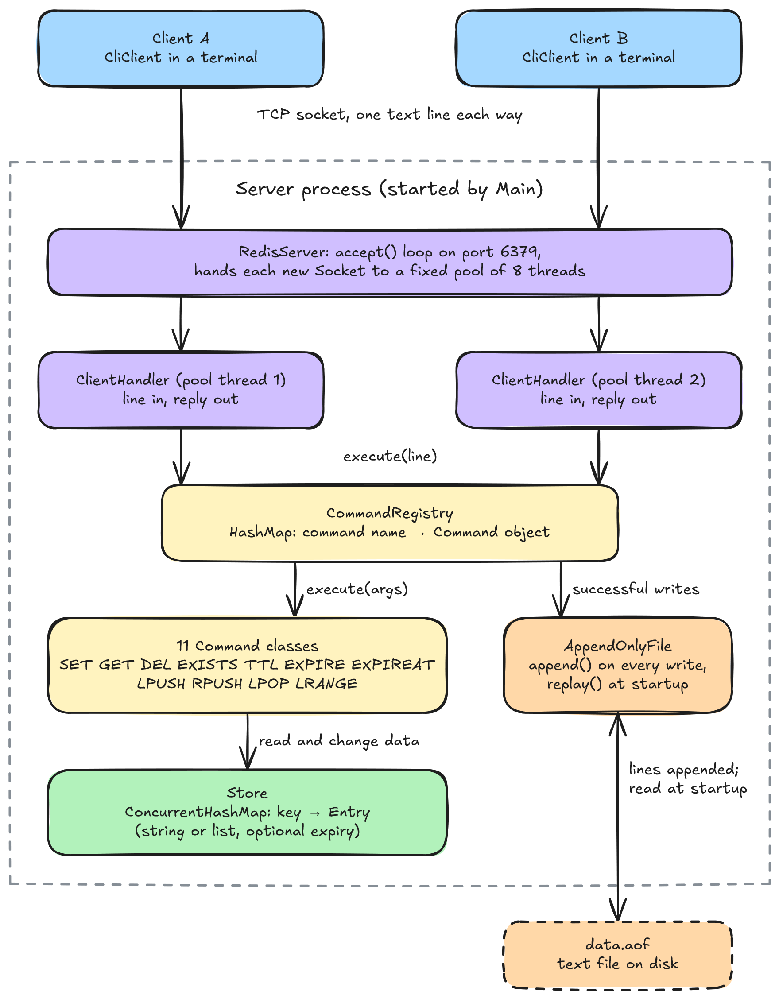

### Use case diagram

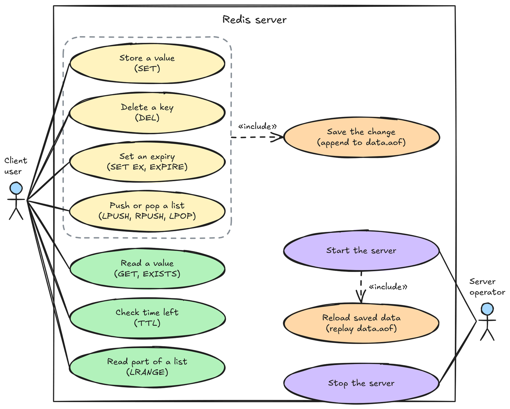

### Class diagram

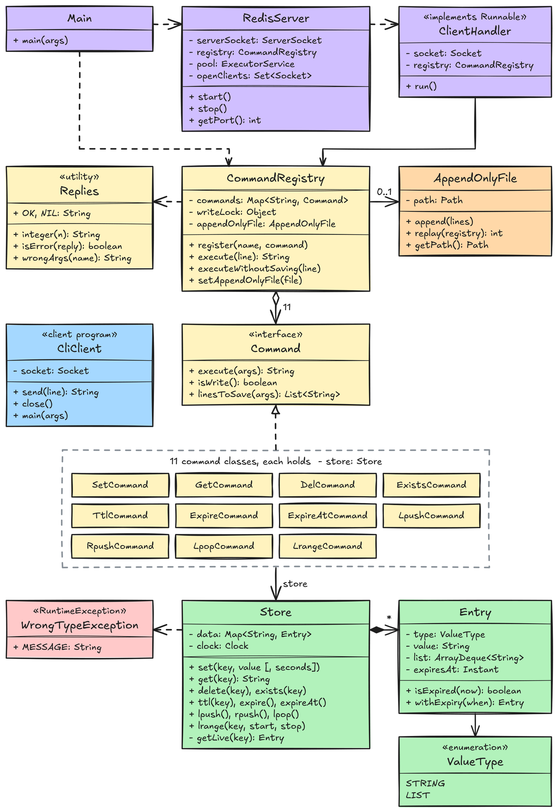

### Activity diagram: handling the command lines of one client

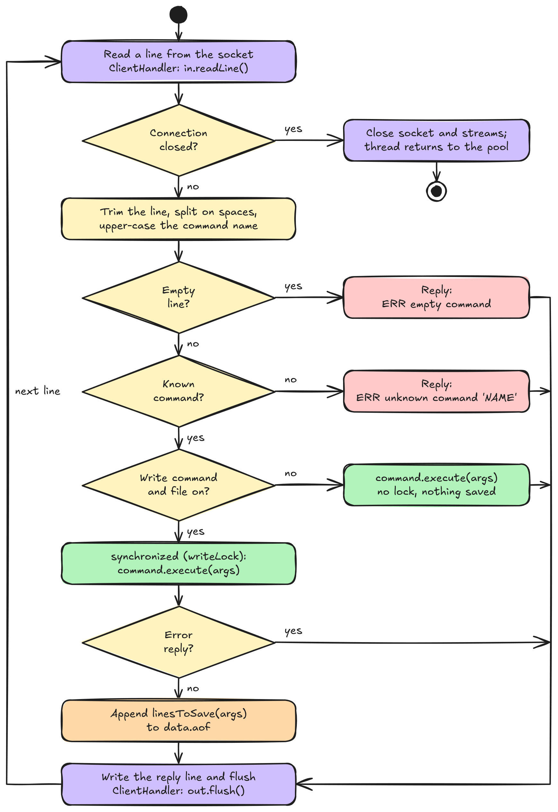

### Saving a change while the server runs, and restoring the data when it starts

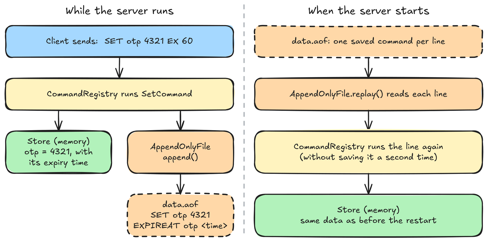

### The shop without a cache, and with the server as its cache

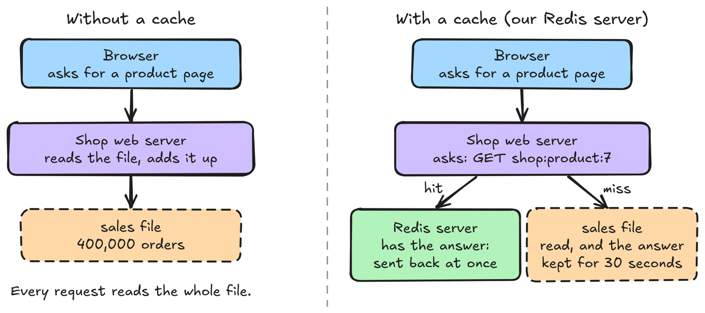

### Activity diagram: one page request of the shop

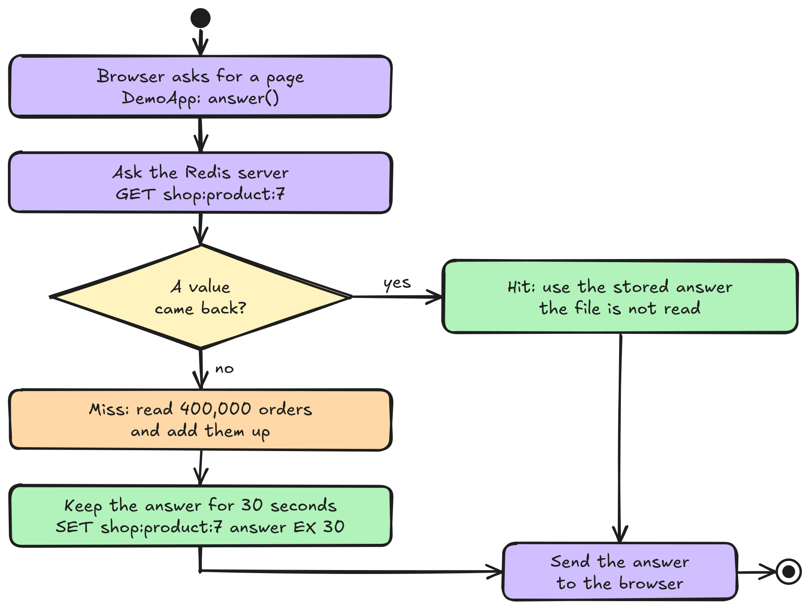

## Screenshots

### The server starting, and a client connected to it

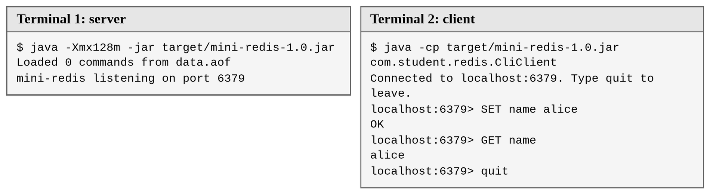

### Two clients sharing values, a key with a time limit, and a list

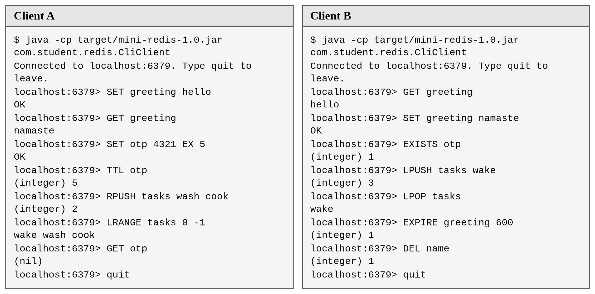

### The saved file, and the data read back after a restart

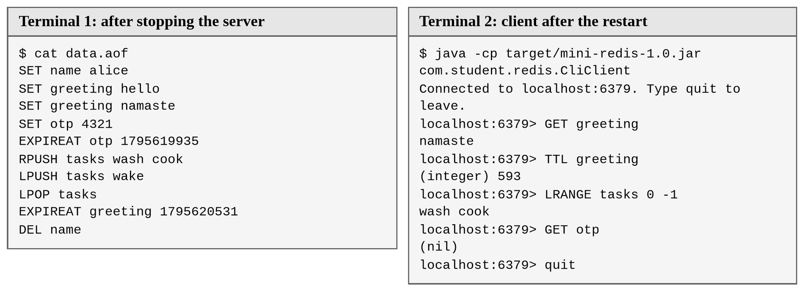

### Error replies for wrong commands, and a client started without a server

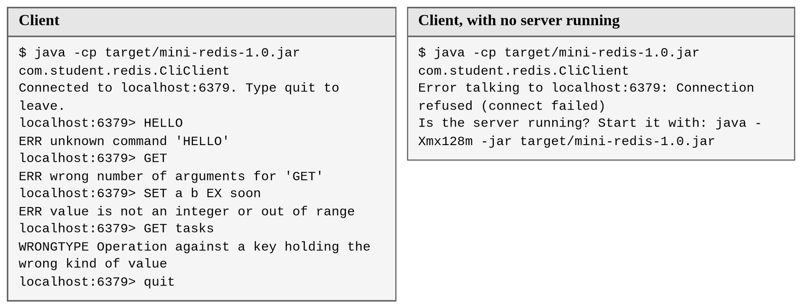

### Output of the benchmark: 200 requests without the cache, then with it

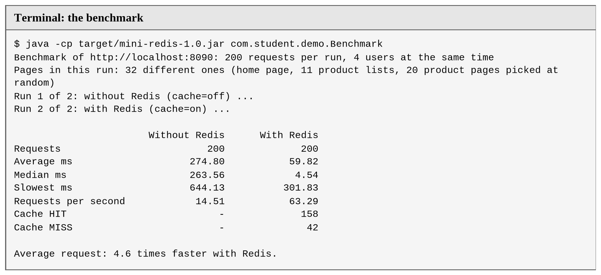

## License

[MIT](LICENSE)
